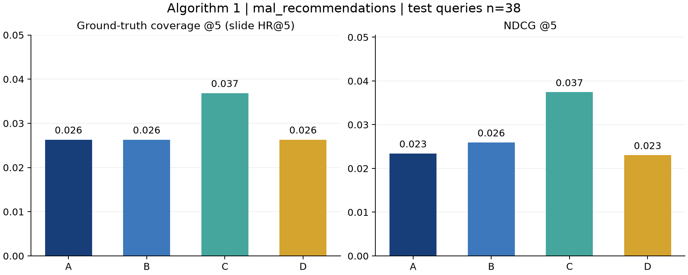

# 算法①：四种相似动漫算法的独立实验报告

运行时间（UTC）：2026-09-30T07:55:24.741156+00:00。数据版本：`20260918_A_final_v1_4a2e38e69be5`。

## 1. 结论

本次已完成 A/B/C/D 四种算法的真实计算、同候选库 Top-5 对比和独立来源评测。用户确认暂时没有人工标注，因此本轮依据 MAL 推荐做评测，人工主验收仍待补齐。未修改或启动应用系统。

测试集有效目标 **38** 个，每个目标从 **14,201** 个非自身作品中选择 Top-5。结果只代表本次有标签的目标，不外推为全站效果。

| 方法 | 图片 HR@5＝覆盖率 | NDCG@5 | 标准 Hit Rate@5 | 相对 A 覆盖率变化 | 达到图片双条件 |
|---|---:|---:|---:|---:|---|
| A | 2.63% | 0.0234 | 7.89% | 基线 | — |
| B | 2.63% | 0.0259 | 7.89% | +0.00 pp | 否 |
| C | 3.68% | 0.0374 | 18.42% | +1.05 pp | 否 |
| D | 2.63% | 0.0230 | 7.89% | +0.00 pp | 否 |

**本轮建议保留 A：B/C/D 均未达到双条件。** 覆盖率最高的候选为 C，相对 A 提升 1.05 个百分点。不能把“分数最好”直接写成“满足替换门槛”。绝对覆盖率较低，说明仅有五维属性与 MAL 用户相似偏好仍有明显距离；并非已经达到可上线质量。

替换规则严格为：覆盖率至少提升 **2 个百分点**，且 NDCG@5 不下降；两项必须同时满足。不会因为训练 AUC 较高、某个示例看起来更好，或仅命中率上升就建议替换。

### 成对 bootstrap 不确定性

固定随机种子，对同一批目标重采样 3,000 次；下表是 95% 差值区间，不是总体效果保证。区间跨 0 时证据不稳定。没有为选出赢家重新调参或更换目标。

| 方法相对 A | 覆盖率变化 95% CI（百分点） | NDCG 变化 95% CI |
|---|---|---|
| B | [-2.11, +2.11] | [-0.0190, +0.0268] |
| C | [-2.63, +4.21] | [-0.0198, +0.0474] |
| D | [+0.00, +0.00] | [-0.0012, +0.0000] |

## 2. 数据、抽样及独立真值

原 E 盘目录是 B 阶段 provisional 数据；采用后续 C 盘正式交付版本。原始正式包已通过 523 个文件哈希和 7 项结构检查。本文件夹只提取算法必需的五维元数据，不复制全部用户资料或 2,395 万行评分。提取规则与输入哈希见 `data/provenance.json`。

先固定 120 个目标：20 个演示用知名作品，另从会员数四分位各随机抽取 25 个作品。按目标 ID 的固定哈希划分 validation/test；全部目标 ID 都从逻辑回归训练对的两个端点排除。四种方法参数预先固定，validation 只作诊断展示，最终结论只使用 test。

MAL 采集：53 个目标具备至少 3 条目录内推荐，67 个不足 3 条，0 个请求/页面解析失败；固定目标总数 120。所有被排除目标均保留审计记录，没有根据算法成绩删除目标。

优先读取 Jikan 的 MAL 推荐接口；失败时读取 MAL 原站 userrecs 页面。按真实推荐人数降序、编号升序取最多 5 条目录内作品，至少 3 条才能进入评测。原始 API 响应或网页 gzip、访问时间、URL 和 SHA-256 一同交付。页面解析只读取推荐卡片及其人数，不把侧栏作品链接当推荐。

这是不完整的正例集合：未列入前 5 的作品仍可能相似，自动指标会低估其他合理答案。热门作品更容易取得推荐，自动评测不能替代人工标注。

| 抽样组 | 有效 MAL 目标数 |
|---|---:|
| anchor | 20 |
| popularity_q1 | 1 |
| popularity_q2 | 4 |
| popularity_q3 | 8 |
| popularity_q4 | 20 |

分组的 validation/test 指标完整保存在 `summary.json → strata`，不把知名作品的结果冒充均匀随机抽样效果。

系列关系仅用于 sanity check：使用正式目录的直接 Prequel/Sequel 边，单独报告，不混入 MAL/人工真值、不参与训练标签、不作为替换依据。

## 3. 四种算法与数据适配

共同五维输入是 genre、theme、demographic、studio、episodes。genre/theme 去重后做集合 Jaccard；受众取排序后的首个非空值，工作室取源数组的首个名称。名称中的逗号保留；单值采用忽略大小写的精确匹配。已知为空与缺失均不生成匹配奖励。

数据中 45 部有多受众、910 部有多工作室。实际词表为 20 个 genre、53 个 theme，不硬编码幻灯片示例词表大小。完整缺失统计见下表；这些投影规则对四种算法完全相同。

| 字段 | 空/缺失数量 |
|---|---:|
| genres | 1402 |
| themes | 4413 |
| demographic | 8917 |
| studio | 3014 |
| episodes | 23 |

- **A**：`0.35×genre + 0.30×theme + 0.15×demographic + 0.10×studio + 0.10×length`。集数相似度沿用仓库 `1/(1+abs(e1-e2)/12)`；未知集数沿用 0.5。准确名称是五维加权相似度，后三维并非集合 Jaccard。
- **B**：与 A 完全相同的五个数值特征，`sigmoid(w·x+b)` 作为排序分数。固定 L2 正则 C=1，用 L-BFGS 的梯度优化拟合逻辑回归。系数不强制非负或和为 1；该概率针对弱标签，不能解释为真实相似概率。
- **C**：仅把五个维度拼成英文属性描述，不加入标题、简介、关系或评分。用原始 BGE small en v1.5 ONNX 浮点权重，CLS 池化、L2 归一化，余弦相似度排序。英文模型符合当前英文属性；未验证中文自然语言检索。
- **D**：标签路径固定采用 A；语义余弦统一映射 `(cos+1)/2` 到 [0,1]，`0.6×A + 0.4×semantic`。不按每个查询重新做 min-max，不额外训练、不按结果调融合权重。

所有方法按未四舍五入分数降序、MAL ID 升序稳定排序，排除目标自身。新用户无需历史；本次全部评测目标也未出现在 LR 训练对中。新增作品需具有同样元数据，C/D 对新增作品还需生成对应向量；交付向量绑定本次冻结目录。

## 4. 训练与向量构建的实际记录

弱监督数据为 50,000 个共同高分正例和 50,000 个随机负例；用户评分只读取 `ratings_train.npz` 的原始 1–10 分。每个访问用户最多贡献一个正例，评分阈值 ≥8；随机负例排除已采样正例，但仍可能含假负例。按无向作品对的固定哈希分为 80,075 个拟合样本和 19,925 个代理验证样本。训练样本交付只包含作品对，不含评分用户编号或用户名；MAL 原网页证据保留公开推荐者署名。

代理验证 AUC=0.7183，LogLoss=0.6202。这两个数字不是相似动漫排序指标。

学习系数（genre/theme/demographic/studio/length）：`[1.664253, 1.935426, 1.273761, 1.478321, -1.143306]`；截距 `0.127151`。集数系数为负也原样保留，反映共同喜好弱标签与相似性目标可能不一致，没有在看到评测结果后手工改权重。

BGE 模型：`BAAI/bge-small-en-v1.5`，revision `5c38ec7c405ec4b44b94cc5a9bb96e735b38267a`；384 维，CPU 4 线程，batch=64，最大长度 128；截断 0 部。全量编码耗时 **191.2s**。模型与 tokenizer 哈希、向量哈希见 `models/bge_metadata.json`。

本机环境：Python 3.12.14，Windows-11-10.0.26200-SP0。依赖版本写入 `summary.json` 和 `requirements.lock.txt`。实验引擎加载约 0.287s；一次共同目标计算四种方法并排序的中位延迟约 93.53ms、P95 约 128.08ms。它们是本地离线耗时，不是系统接口或并发性能。

## 5. 验收与复现

运行命令见上级 `README.md`。`test_core.py` 覆盖空值、单值/集合区别、长度、归一化、稳定排序、自排除、指标定义、双条件门槛和人工标注导入；`test_artifacts.py` 核对真实训练隔离、原始推荐证据、指标复算与离线推荐。完整运行输出保存到 `tests.txt`。`DELIVERY_MANIFEST.json` 用于交付文件哈希校验。

人工标注表见 `data/human_annotations_template.csv`。每个目标填写 3–5 个目录内作品 ID（分号分隔）、标注人、理由并设 status=verified；不要根据四种算法结果倒推标签。建议两位熟悉作品的同学独立标注后协商争议，再运行 `python -m kbbench.evaluate --human <完成表.csv>`，另写到 `results/human/`。

## 6. 明确边界

人工主验收尚未完成；MAL 推荐有人群与热度偏差，长尾无标签且未被当作负例；多工作室被压缩为单值；缺失属性可能造成相同标签文本；训练共同喜好并不等价于内容相似。保留这些限制是为了让结果可解释，而不是将低分改成预期结论。未执行系统联调、线上替换或系统性能测试。
