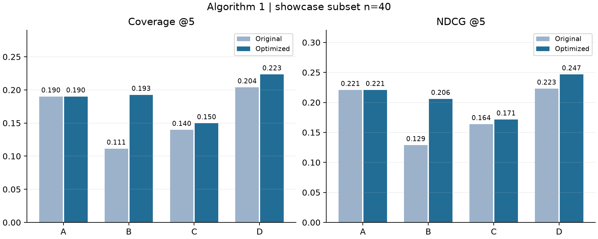

# 算法①高一致性展示子集

本页选取 40 部目标动漫，仅用于课堂展示和逐例说明，不替代完整的 234 部 MAL 测试集。

## 选择规则

从已冻结、已评测的 234 部 MAL 测试目标中，按四种方法的 `coverage@5 + NDCG@5` 平均值降序取前 40 部；并列按 MAL ID 升序。这个规则使用了保存的真值和预测结果，因此是事后展示筛选，不能用于声称总体效果、模型选择或正式替换。

## 展示结果

| 方法 | 原配方覆盖率@5 | 优化后覆盖率@5 | 原配方 NDCG@5 | 优化后 NDCG@5 |
|---|---:|---:|---:|---:|
| A | 19.00% | 19.00% | 0.2207 | 0.2207 |
| B | 11.12% | 19.25% | 0.1286 | 0.2058 |
| C | 13.96% | 14.96% | 0.1637 | 0.1715 |
| D | 20.38% | 22.33% | 0.2229 | 0.2466 |

这个子集的数值较高，是因为目标按照已观察到的模型与 MAL 推荐一致程度筛选；它适合展示推荐案例，不代表随机目标或全目录表现。完整总体结果仍见上级 [REPORT.md](../REPORT.md)。

目标 ID 与筛选排名见实验目录中的 `data/showcase_targets.jsonl`。
