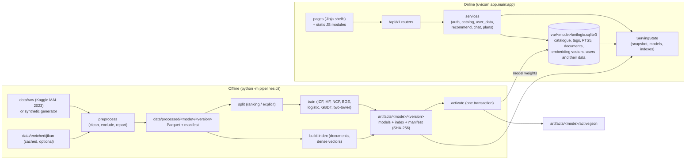

# Architecture

AniLogic is a **modular monolith**: one FastAPI process serves the JSON API and the server-rendered page
shells, reads one SQLite business database, and holds an in-memory *serving state* (catalogue snapshot,
models, vector indexes). The catalogue, documents and embedding vectors of the active version come from the
database; only model weights are read from the versioned artifact bundle. Everything heavy (cleaning 24M ratings,
training, embedding, indexing) runs offline through the `pipelines` CLI.



## 1. Boundaries

| Layer | Package | Responsibility | Must not |
|---|---|---|---|
| HTTP | `app/api/v1/*`, `app/web/pages.py` | validation (Pydantic, unknown fields rejected), auth/CSRF dependencies, response shapes | contain business rules |
| Services | `app/services/*` | use cases: ownership checks, constraint application, caching, recording runs | know about HTTP |
| Algorithms | `app/recommendation`, `app/retrieval`, `app/chat`, `app/planning`, `app/graph`, `app/multimodal` | pure computation over the snapshot and model objects | touch the database directly (except the retrieval/graph readers) |
| Data access | `app/db` | SQLAlchemy models, sessions (FK on, WAL, busy timeout), write retry | - |
| Offline | `pipelines/*` | validate, preprocess, split, train, index, activate, enrich, migrate | run inside a request |
| Evaluation | `evaluation/*` | experiments over versioned artifacts, sandbox DB copies, reports | write to the real business DB |

Frontend rule (`DEVLOG.md` rule 6): one page = one template in `app/web/templates/` plus one module in
`app/web/static/js/pages/` with the same name; shared code in `js/common.js`, shared styles in `css/style.css`.
Pages are thin shells: every piece of data comes from the versioned JSON API.

## 2. Data and versions

* **Item identity**: `mal:<id>` for real titles, `synthetic:<seed>:<n>` for fictional ones. Offline Kaggle user ids
  and application user ids are separate namespaces and are never joined.
* **Dataset version** (`real-<hash>` / `synthetic-<hash>`): a hash of the source files, the pipeline version, the
  relevant config and, for real data, the preprocessing version. Identical inputs give the same version, and a
  changed input or processing rule gives a new one.
* **Processed dataset** (`data/processed/<mode>/<version>/`): the catalogue Parquet (row order = catalogue index),
  tags, aliases, relations, characters, partitioned ratings, labels, reports and a manifest with SHA-256 checksums.
* **Artifacts** (`artifacts/<mode>/<version>/`): a self-contained catalogue copy, training statistics, models,
  embeddings and the retrieval index. `manifest.json` records versions, parameters, metrics, the split
  fingerprint, dependency versions and per-file checksums.
* **Activation** (`pipelines/activate.py`) verifies the artifacts and, in **one transaction**, loads into the
  business database everything serving reads except model weights (table below), rebuilds FTS5 and records the
  manifest checksum; it then switches `active.json`. User data is never deleted: titles that disappear stay
  referenced but hidden (`in_catalog = 0`, `catalog_position = NULL`).

| Business database (`var/<mode>/anilogic.sqlite3`) | Artifact bundle (`artifacts/<mode>/<version>/`) |
|---|---|
| `anime`: the whole catalogue of the active version, row order in `catalog_position` (= catalogue index the models use), unserved titles with `in_catalog = 0`, train-split rating counts in `train_interactions` | `models/`: ICF, MF, NCF, logistic, GBDT, two-tower weights, `cf_items` mapping |
| `tags` / `anime_tags`, `anime_aliases`, `relations`, `characters`, `scenes`, `scene_images`, `knowledge_documents`, FTS5 tables | `index/lsa.joblib` (LSA query encoder, when LSA is the text encoder) |
| `anime_embeddings`, `document_embeddings`, `scene_image_embeddings`: one vector per row (raw float32 bytes); `vector_sets`: dim, dtype, count, info and the SHA-256 of each matrix | `manifest.json` (checksums; serving checks it against the activation record) |
| `supplement_tags`: the algorithm-2 theme / demographic table (real mode, from `algorithm1_benchmark/data/catalog.jsonl.gz`) | the catalogue / embedding / index files stay as the activation input and for offline experiments |
| users, sessions, ratings, collections, progress, preferences, exclusions, feedback, chats, plans, runs | |

## 3. Serving state

`app/services/serving.py` builds a `ServingState` for the active version: the catalogue snapshot (numpy arrays +
tag matrices), ICF neighbours, MF/NCF models, attribute embeddings, similarity and collection scorers, the dense
retrieval index, the title resolver and the image gallery. Catalogue, tags, aliases, counts, vectors and the
algorithm-2 supplement are read from the database (each vector set is checked against its dataset version, row
count and SHA-256); model files are verified against the manifest. A mismatch sets the capability to
`artifact_mismatch` and serving degrades instead of mixing versions.

A request takes **one reference** to the current state and uses it throughout. When the database reports a newer
active version, a new state is built and swapped in as a whole, so a request never pairs a new index with an old
id mapping. Each capability carries a status (`ready`, `degraded`, `not_configured`, `missing_data`,
`artifact_mismatch`, `failed`, `limited_by_data`, `limited_by_credentials`), shown on `/status` and returned by
`/api/v1/system/status`.

## 4. Request path

1. Middleware assigns a request id, rejects cross-origin writes, and adds security headers (CSP `script-src 'self'`,
   no inline scripts or styles, `X-Frame-Options: DENY`, `nosniff`, `Referrer-Policy: same-origin`).
2. Dependencies resolve the session from the HttpOnly cookie (only its SHA-256 is stored) and check the CSRF
   header (`X-CSRF-Token`, verified against the stored hash) on every write.
3. Route handlers are plain `def` functions, so FastAPI runs them in a bounded thread pool
   (`app.cpu_workers x 4` threads) and CPU-heavy work never blocks the event loop.
4. Services apply ownership checks. Another user's resource is reported as *not found*, not *forbidden*.
5. Errors use one envelope, `{"error": {"code", "message", "details", "request_id"}}`, with no stack traces or
   paths. Business outcomes such as "no titles match" are successful responses with warnings, not errors.

## 5. One constraint engine

Browsing, collection recommendations, the home feed, chat retrieval and the planner all use
`app/recommendation/constraints.py`. Rules have an id, a source and a relaxable flag, and are evaluated as
vectorised masks. A missing value never satisfies a hard filter. Relaxations are returned as suggestions next to
an empty strict result and are applied only when the user chooses one.

## 6. Caching and invalidation

Recommendation results are cached in an in-process LRU keyed by a fingerprint of (dataset version, user
`profile_version`, request parameters). Every write that can change recommendations (rating, collection
membership, progress, preference, exclusion, feedback) increments `users.profile_version`, so stale entries are
never served. Cache hits are marked `meta.cached = true`.

## 7. Security model

| Concern | Mechanism |
|---|---|
| Passwords | argon2id (`argon2-cffi`); legacy PBKDF2 hashes verify once and are re-hashed |
| Sessions | 256-bit random token in an HttpOnly, SameSite=Lax cookie; only its hash is stored; TTL `app.session_ttl_hours` |
| CSRF | double submit: readable `anilogic_csrf` cookie + `X-CSRF-Token` header, compared with the stored hash; cross-origin writes rejected |
| Login abuse | generic error message; at most 8 failed attempts per username in 10 minutes (in-process throttle) |
| Authorisation | server-side ownership on every private resource; admin endpoints require `is_admin` (no default admin account) |
| Output | CSP without inline code; user and model text rendered with `textContent` |
| LLM | key only from `ANILOGIC_LLM_API_KEY`; evidence passed as delimited untrusted data; answers validated before display |
| Uploads | size / pixel / format checks, decoded in memory, not retained by default |
| Logs | JSON lines with request ids; no passwords, cookies, keys or (by default) chat text |

## 8. Why this architecture

* **Rebuild, not wrap.** The legacy code let any client act as any user (see `docs/legacy-feature-audit.md` §3)
  and computed everything in request handlers over 24 hand-written titles. Wrapping it would have kept both
  problems.
* **Offline or online split.** With 24M ratings, similarity matrices and embeddings are built once per dataset
  version. Requests only look things up and do light math (ICF prediction, GA over 20 candidates), so p95
  latency stays in the tens to hundreds of milliseconds (see the system evaluation report).
* **Modular monolith over services.** One team, one machine, one SQLite file: separate services would add
  deployment and consistency problems without a scaling need. Module boundaries still keep algorithms
  testable in isolation.
* **SQLite.** The business data is small and mostly single-writer. WAL, a busy timeout and short transactions
  with a bounded retry are enough (measured: 90 concurrent rating writes, 0 failures). The large offline data
  lives in Parquet, not in the database.
* **Versioned artifacts + atomic activation.** Models, indexes and id mappings are only valid together. Checksums
  and a single active pointer make "new index with an old mapping" impossible, and make every evaluation traceable
  to exact inputs.

## 9. Directory map

```
app/            FastAPI app: api/v1, services, recommendation, retrieval, chat, planning, graph, multimodal, db, web
pipelines/      CLI + offline jobs (synthetic generator, real ingest, split, fit, build_index, activate, jikan, migration)
evaluation/     metrics, protocols, experiments, runner, reports; runs/<run_id>/ per experiment
configs/        base.yaml + synthetic.yaml / real.yaml overlays
migrations/     Alembic (schema + FTS5)
tests/          unit, integration (miniature synthetic world), e2e (Playwright)
data/           raw / enriched / processed / synthetic (git-ignored) + README and evaluation templates
artifacts/      models and indexes per mode and version (git-ignored)
var/            business databases, logs, pipeline run records (git-ignored)
docs/           this documentation, OpenAPI, evaluation results, screenshots
```
