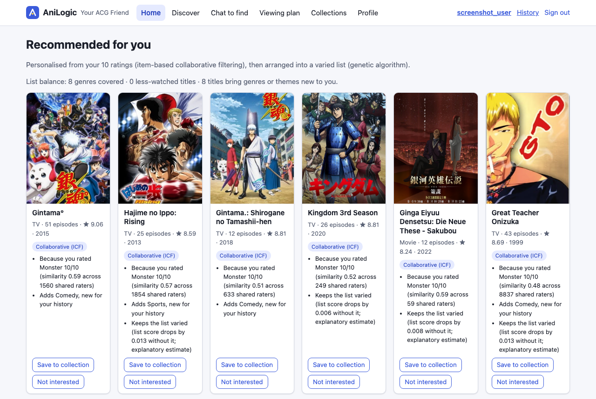
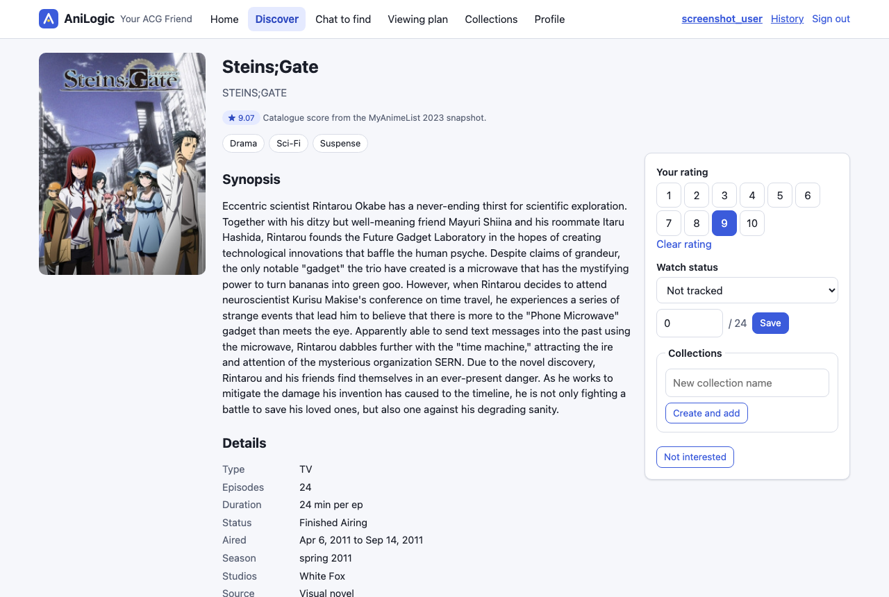
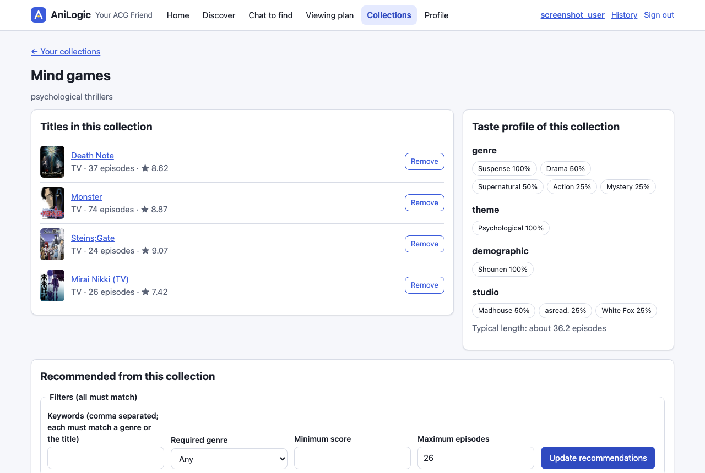
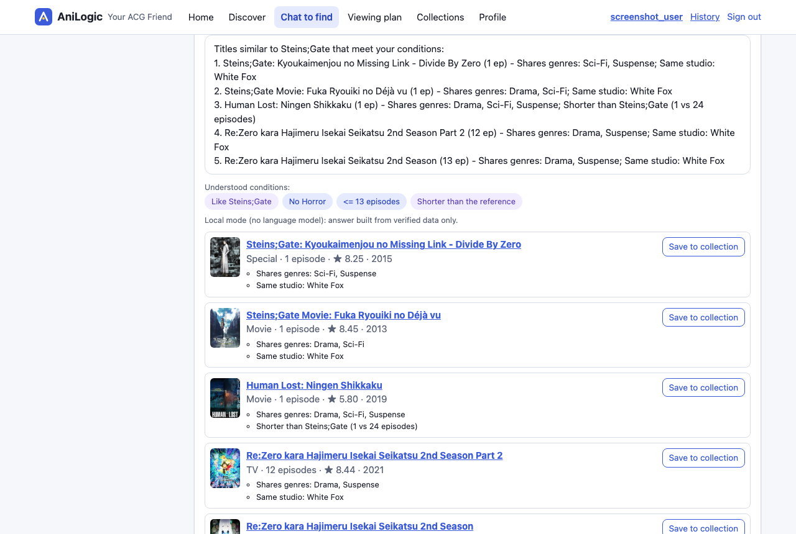
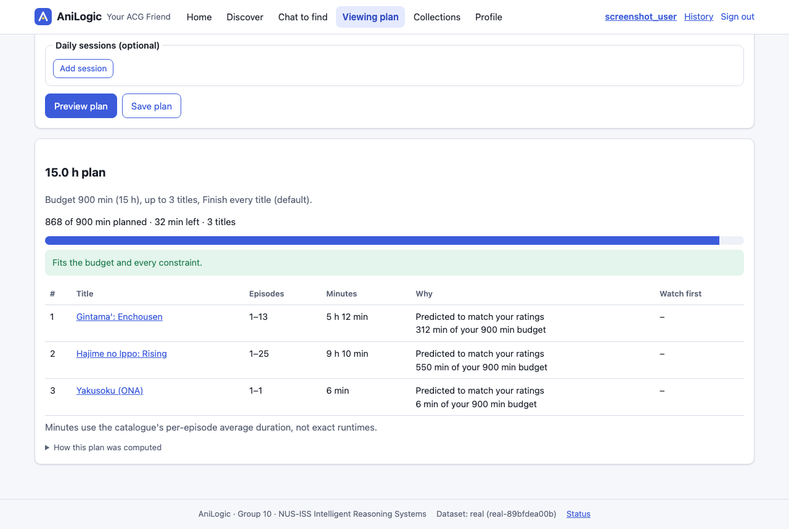
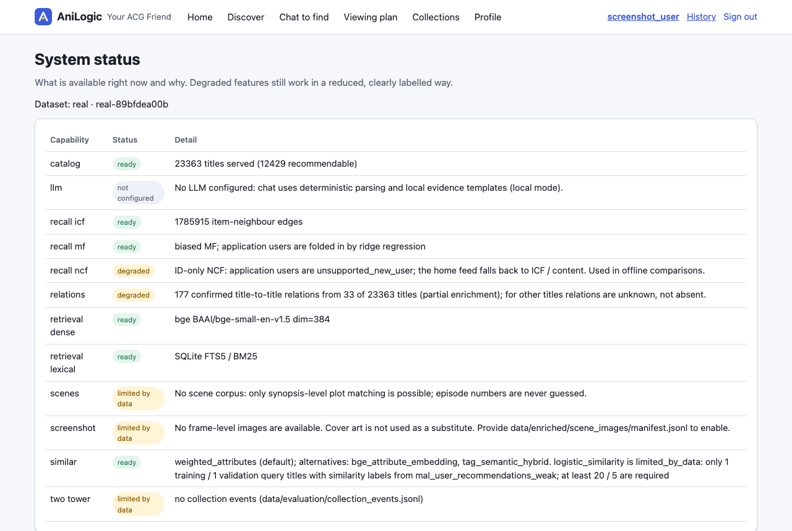

# User guide

AniLogic helps you find anime and plan what to watch. This guide walks through the main tasks. Screenshots are
from the real-data mode (MyAnimeList 2023 snapshot).

## Accounts

* **Create an account** on `/register` (username 3-32 letters, digits, `_ - .`; password at least 8 characters).
  Browsing and title pages work without an account. Ratings, collections, chat, plans and personalised
  recommendations need one.
* **Demo accounts** exist only in the **synthetic** demo world (`make seed`), never in real mode. All use the
  password `anilogic-demo`:

| Account | Taste |
|---|---|
| `demo_mystery` | mystery, suspense, psychological |
| `demo_action` | action, adventure, martial arts |
| `demo_healing` | slice of life, iyashikei, music |
| `demo_scifi` | sci-fi, mecha, space, time travel |
| `demo_admin` | administrator: can open `/dev` (algorithm comparisons) |

Synthetic titles are invented, and the site says so on every page.

## 1. First visit

After registering you land on **Welcome**. Pick a few genres and themes you like, and rate any titles you
already know (1-10). Skipping is fine. The home page then shows **Starter picks**: well-known, well-rated titles
that match your tags. Once you have rated a few titles it switches to **Warming up**, and after 8 ratings to
**Personalised**. The label at the top of the list always says which mode you are in.

## 2. Find a title and see similar ones

**Discover** searches titles (English, Japanese romanised or alternative names; small typos are tolerated) and
filters by genre, type, maximum episodes and minimum score, sorted by relevance, popularity, score, year or title.
Unknown values show as "unknown", never as 0.

A **title page** shows the facts with their sources, your rating, your collections and your progress, plus
**Similar titles** (five by default). Each suggestion says why it was picked ("Shares genres: ...", "Similar
length (26 vs 24 episodes)") and which details could not be compared.

## 3. Collections and "more like this collection"

**Collections** lets you create named lists; a title can be in several. Open one to see its **taste profile**
(its most common genres and themes, typical length) and **recommendations for this collection**.

Filters (keywords, genre, minimum score, maximum episodes) are strict. If nothing matches, the list stays empty
and AniLogic suggests one change (for example "Lowering the minimum score from 9.9 to 7.4 gives 8 titles").
Nothing is relaxed unless you click the suggestion. Afterwards the results say which filter you relaxed.

## 4. Rate, track and give feedback

* Rate a title 1-10 on its page; **Clear rating** removes it. Ratings update your recommendations immediately.
* **Progress** (watching / completed / episodes watched) is used by viewing plans. Completed titles are not
  recommended again.
* **Not interested** hides a title everywhere. **Profile → Not interested** lists them, and **Undo** brings a
  title back.

## 5. Chat to find

Describe what you want in plain English, for example:

* "a comedy with at most 12 episodes and no horror"
* "something like Steins;Gate but shorter"
* "what is the sequel to Shingeki no Kyojin?"

Conditions appear as chips, with hard conditions and soft preferences in different colours. You can refine in the next
message ("at most 6 episodes"). Each answer lists the titles (all of which meet the hard conditions) and the
**Evidence** it used, with source references. Without a configured language model, chat runs in
**Local mode**: the same verified facts, written by templates. Questions the sources cannot answer (such as
"which episode has the rooftop scene?" when no scene data exists) get "not in the sources" instead of a guess.
Chinese input understands numbers, genres, negation and title names, but not free-text plot descriptions.

## 6. Plan what to watch

On **Plan**, enter your time budget (for example 15 hours), the maximum number of titles, and optionally genres,
a minimum score, variety, titles you must include, and daily time slots. AniLogic proposes a plan:

* which titles and which episode range of each, with minutes (per-episode averages from the catalogue, so treat
  them as estimates);
* prerequisites first (a confirmed prequel you have not watched is planned before its sequel);
* a budget check ("Fits the budget" or what is wrong), and an optional day-by-day schedule where a movie is never
  split.

Save the plan to edit it (remove a title, change episode ranges). Every edit is checked again. Export as
Markdown, printable HTML or JSON. Titles with an unknown episode count or duration are never planned.

## 7. History, profile and status

* **History** lists your saved plans and chats.
* **Profile** shows your preferences, ratings (with undo), progress and hidden titles.
* **Status** (`/status`) shows which data and features are available right now, for example whether the language
  model is configured or whether scene data exists.

## Privacy

Your data is visible only to you. Passwords are stored as argon2id hashes. Chat text is not written to server
logs. Uploaded screenshots are processed in memory and not kept.
